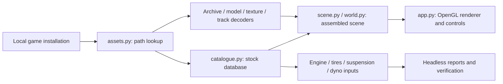

# Architecture

The client separates file decoding, catalogue interpretation, scene assembly, numerical work and rendering. The application entry point is `client.app:main`, exposed as `motor-city`.

## Module map

| Area | Modules | Responsibility |
| --- | --- | --- |
| Entry and preferences | `app.py`, `settings.py` | CLI, OpenGL window, camera controls, per-user preferences |
| Local content | `assets.py`, `tools/viv.py` | Explicit asset root, case-insensitive lookup, bounded archive reads |
| Vehicle geometry | `fce.py`, `textures.py` | Geometry and supported texture decoding, normal repair |
| Track geometry | `track.py`, `track_mesh.py`, `track_spatial.py`, `track_surface.py` | Track sections, rendered meshes, spatial lookup, road support |
| Catalogue | `catalogue.py`, `physics_data.py` | Portable database reading, stock components, typed physics rows |
| Assembly | `assembly.py`, `scene.py`, `world.py` | Body selection, attachments, vehicle/track world scene |
| Motion and contact | `motion.py`, `contact.py` | Recovered pose/velocity updates and wheel support geometry |
| Offline driving | `driving.py`, `racing.py` | Authored fixed-step bicycle model, terrain support, ordered gates and race timing |
| Components | `engine.py`, `tires.py`, `suspension.py` | Component interpretation, dimensions and recovered calculations |
| Engine simulation | `dyno.py`, `dyno_solver.py`, `thermodynamics.py` | External flow templates, input record, portable solver stages and cylinder initialization |
| Developer inspection | `tools/catalog.py`, `tools/query_fields.py` | Asset inventory and database-query metadata |
| Optional oracle | `tools/native_oracle.py`, `tools/verify_*.py` | Bounded CPU comparisons against a local verified executable |

## Boundaries

Decoders consume bytes or local paths and return typed data. Scene modules combine that data without importing the graphics window. Rendering and key handling are concentrated in `app.py`; driving and racing rules are independent modules that run without a graphics context.

The runtime imports no emulation dependency. The optional oracle executes selected original instructions in an isolated CPU emulator for developer comparisons; it supplies no Windows services or original game entry point. The executable and comparison results are not packaged.

## Engine pipeline

`catalogue.py` assembles component-derived inputs. `dyno.py` loads the supported executable's local templates and serializes the core dyno record. `dyno_solver.py` implements verified geometry, timing, flow normalization, cam profiles, lift, interpolation, pressure correction, airflow areas and output conversion.

`thermodynamics.py` initializes pressure, temperature, crank geometry and cylinder mass terms. The caller supplies pressure; carrying it between cycles and integrating the thermodynamic loop remain incomplete. Original solver curves captured during development are comparison evidence, not a replacement for the portable solver. Offline driving uses separate authored acceleration/drag/grip parameters and does not consume the incomplete dyno pipeline.

## Offline simulation

`Drive.update` accumulates frame time and advances at 120 Hz, with catch-up capped at 0.25 seconds. Each accepted step requires four wheel supports. A terrain basis aligns the body to the sampled road normals; absent supports stop motion. This is a terrain-following bicycle model with authored parameters, not recovered suspension, tire or collision response.

`TimeTrial` samples ordered gates from the decoded road slices. It checks forward plane crossings, road width and vertical proximity, then records lap/sprint times with crossing interpolation. Closed courses loop through the start gate; open courses freeze on a finish result until reset. Course closure is inferred from endpoint proximity. Reset clears session times. Window focus loss pauses the simulation; no original server connection is involved.
