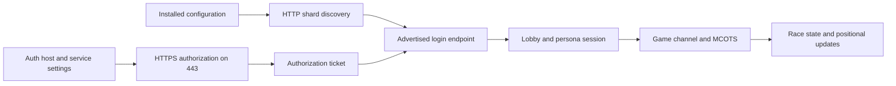

# Fan-server compatibility

The target is the server already configured in the supplied installation.
Discovery and certificate transport are implemented as developer tools. The
client does not yet establish an authenticated lobby or race session. Reaching
an open port is not sufficient evidence of protocol compatibility.

## Observed configuration and live services

On October 12, 2026, both installed shard-list URLs returned the same service
identity, `MotorCity Revival`, shard ID 44:

| Source | Configured URL |
| --- | --- |
| `shardlistip.ini` | `http://auth.novaserv.cc/ShardList` |
| `nps/shardlistip.ini` | `http://mc.novaserv.cc/ShardList` |

The discovery response advertises `mc.novaserv.cc` for login port 8226, lobby
port 7003 and MCOTS port 43300. All three accepted a TCP connection in the local
check. No login, lobby or transaction message was sent in that check. Endpoint
values and status can change; the implementation reads the configured URLs
rather than hardcoding this host into the client.

The installed 32-bit Windows registry separately sets `AuthLoginServer` to
`mc.novaserv.cc` and `AuthLoginBaseService` to `AuthLogin`. Static analysis of
`mcity.exe` at `0x4a46c0` and `0x72d820` traces those settings into loading
`nps/authlogin.dll` and resolving its authorization export. The original auth
DLL connects over HTTPS on port 443. This is distinct from the shard-list's
binary login endpoint on port 8226.



The later links show the integration path to recover and verify, not completed
portable functionality. The exact ticket handoff, packet framing, encryption,
session state and race sequence remain incomplete.

## Installed patch expectations

`scripts/MCOExOps.ini` enables Fast Join and selects positional update code 2,
documented by the patch as 32 Hz. Its existing runtime log reports skipping the
UDP-first branch at `0x4513c7` and changing the position-send mask at `0x5788e3`
from 7 to 1. Static analysis of `0x451370` also finds the original UDP channel
setup path. These agree about the patch's intended transport change; they do
not yet verify the reconstructed race-channel implementation.

The patch declares a SHA1 server-certificate pin. This value is read from the
local file and is not a public hardcoded fallback. Missing fields remain unknown;
positional code 0 means native behavior, whose rate is not invented by the reader.
TCP-first joining, send cadence, lag handling and content/version expectations
must be verified with the configured server before online compatibility is claimed.

## Certificate compatibility

The platform's default OpenSSL policy rejected the observed HTTPS certificate
with `EE certificate key too weak`. A certificate-only connection using a scoped
legacy policy negotiated TLS 1.3, and the certificate's fingerprint exactly
matched the installed patch pin. A subsequent pinned HTTPS GET to `/` returned
HTTP 200 and `OK`.

`PinnedHTTPSConnection` implements that explicit compatibility path: it permits
the legacy certificate policy only for that connection, keeps TLS 1.2 as its
minimum, and checks the exact configured certificate before sending HTTP bytes.
A mismatch closes the connection. It does not change global certificate settings
or install a Windows trust root. SHA1 pinning reproduces the installed patch's
certificate identity convention; it is not a recommendation for a new PKI design.

The unit suite checks that a mismatched certificate prevents an HTTP request's
payload from being sent. The [manual live transport run](https://github.com/Dadud/motor-city-reconstruction/actions/runs/38321930343)
also passed on both Ubuntu and Windows runners using the configured endpoint
and certificate pin. Both artifact reports record one parsed shard, an exact
certificate match and TLS 1.3, with no TLS application data sent. This establishes
cross-platform discovery and certificate transport, not authenticated gameplay.

## Recovered authorization format

The analyzed `authlogin.dll` has SHA-256
`b4822e997cd86c0890fafb6a395013d61daa413f70880d3e26e8b660a24635f6`.
Its request builder at `0x10001fa0` constructs a GET query containing `username`,
an optional `password`, `serviceID`, and `version=2.5`. Optional client-IP and
IGR fields exist in a separate branch. The service ID and complete caller
sequence must be recovered before a real login is attempted.

The password encoder at `0x100027d0` selectively percent-escapes punctuation,
using `%20` for a space rather than `+`. The portable helper supports printable
ASCII; original narrow-character behavior for other encodings remains unknown.
Username and service ID are appended differently in the original. The initial
portable interface rejects ambiguous query characters rather than allowing query
injection. It must be expanded with evidence if legitimate names require them.

The response parser at `0x10004090` consumes case-sensitive fields including
`Valid`, `reasoncode`, `reasontext` and `Ticket`. `Valid=TRUE` indicates the
native valid branch. Helpers at `0x10007010`, `0x100071b0` and `0x10007370`
establish newline-delimited entries, leading `#` comments, and separator
precedence `=`, space, tab, comma. The portable parser adds bounds and rejects
a success without a ticket. Exact native tolerance for malformed responses is
not claimed.

Query targets contain credentials. Do not log them, place them in command-line
arguments, commit them or export them as evidence. Ticket and diagnostic text
are excluded from the response object's representation. No real credentials
have been submitted by the reconstruction during these checks.

## Reproduce discovery and certificate checks

```powershell
.\.venv\Scripts\python.exe -m tools.server_check 'C:\Program Files (x86)\EA Games\Motor City Online' --fetch --check-auth-tls
```

```sh
python -m tools.server_check '/path/to/game' --fetch --check-auth-tls --auth-host mc.novaserv.cc
```

The explicit Linux host above reflects this installation's observed registry
value. Select the host from the user's actual configuration for another server.
The TLS option performs certificate verification without application data;
`--fetch` performs public discovery GETs. The report labels its limited coverage.
No account creation or persistent original configuration changes occur.

## Evidence required for confidence

### Login success response

`client/nps_response.py` decodes the `0x601` payload read by native function
`0x72bf90`. Its recovered order is two big-endian uint32 values (the login caller
uses the first as user ID), one byte converted to boolean, three nested records,
another uint32, and a length-prefixed string of up to 64 bytes. Each nested record
has a big-endian uint16 byte length and contains payload without an outer header.

The first two records are read by `0x72bcf0`: three uint32 values, followed by
strings with capacities 64, 256, and 256 bytes. Native `0x72bd80` checks whether
the second uint32 is nonzero and the third is zero or greater than the current
signed 32-bit `time_t`. The authored `active_at` method preserves that signed
expiry comparison, including the original post-2038 limitation.

The third record is read by `0x71d700`: a length-prefixed field of up to 32 bytes
and a uint32 value. The login caller retains this material for its session.
The decoder does not yet infer a cipher or interpret the remaining numeric fields.
Sensitive strings and session material are excluded from diagnostic reprs.

The original reader comparison matched three synthetic cases containing zero,
one, and 32-byte session material. It runs the original reader and nested virtual
methods under Unicorn, replacing only ntohs/ntohl with specified byte swaps.
It checks decoded fields and the final reader cursor. Repeat with:

```sh
python -m tools.nps_response_oracle '/path/to/original/mcity.exe'
```

The portable decoder rejects truncation, oversized fields, and trailing bytes.
The native bounded-string helper can truncate oversized fields and advance only
by the copied length; that malformed-input behavior is not reproduced. No live
successful response has been captured or decoded yet.

Response evidence:
`ev_cd949004a2b40d4aced0d994805387b832855d718a859420f40f77f3a73c346b`.
Nested record evidence:
`ev_5ad41516f233dd45ab7d8f8d8e454b55a2cc101985cf643a59215fe841982af2`.
Expiry evidence:
`ev_a172eb653ed0a675aef2a2f13d9fb22b47e8435e7e6ed034fd52700324af57fc`.

### Recovered binary framing

`client/nps_framing.py` implements the framing observed in the main executable
serializer at `0x7e0800` and receiver at `0x72f600`. The first two big-endian
16-bit fields contain message ID and total byte length. The receiver reads those
four bytes, then exactly the remaining length. Its socket helper at `0x7e2da0`
loops over partial reads; the sender at `0x7e2c80` retries partial sends.

The serializer's header-enabled branch writes this layout:

| Byte offset | Width | Observed value |
| --- | --- | --- |
| 0 | 2 | Message ID |
| 2 | 2 | Total length including header |
| 4 | 2 | `0x0101` for IDs `0x501..0x51a` and `0x521..0x526`, otherwise zero |
| 6 | 2 | Zero |
| 8 | 4 | Object field or virtual-method result; meaning unresolved |
| 12 | variable | Message-specific payload |

The receiver permits four-byte frames. Their purpose is unresolved, so the codec
retains them without pretending they contain a full message header. Unknown IDs
and payloads remain opaque. Framing tests cover every split point in a multi-frame
stream, single-byte fragments, coalesced frames, maximum length, malformed length,
and truncated EOF. These are synthetic tests, not captured successful logins.

The original login path sends ID `0x501` and handles `0x601` as success. Observed
failure branches include `0x602` (user not found), `0x610` (not authorized),
`0x623` (authorization denied), `0x626` (banned), and `0x637` (CRC mismatch).
CRC/session calculation and ticket binding remain unresolved.
No fabricated binary login messages have been submitted to the live server.

`client/nps_login.py` now implements the recovered `0x501` payload serializer at
`0x72c120`. Strings use a big-endian 16-bit byte count and exclude the trailing
NUL, as established by helper `0x7e0c90`. The field order is:

| Field | Wire representation | Original capacity/origin |
| --- | --- | --- |
| Ticket | Length-prefixed narrow string | 128 bytes; authorization response |
| Authorization mode | Big-endian uint16 | HTTPS branch sets 0; alternate NPS AAI branch sets 1 |
| Opaque string | Length-prefixed narrow string | 512 bytes; generated by `0x72c3f0` |
| Service ID | Length-prefixed narrow string | 64 bytes; login caller supplies it |
| Caller value | Big-endian uint32 | Fourth login argument; meaning unresolved |

The codec takes explicit bytes because original narrow-character encoding is
unresolved. It rejects embedded NULs and over-capacity fields instead of silently
truncating them. Ticket and opaque string are excluded from diagnostic reprs.
The original size method at `0x72c0d0` agrees with this layout: twelve payload
overhead bytes plus the three string lengths, and twelve more for the outer header.

The optional original-instruction comparison can be repeated with:

```sh
python -m tools.nps_oracle '/path/to/original/mcity.exe'
```

It matched all 42 synthetic cases on this installation, including empty strings,
maximum capacities, byte values above ASCII, and integer boundaries. It runs the
serializer in Unicorn with specified byte-swap replacements for htons/htonl;
it does not launch the original application or contact any server. No original
instruction bytes are distributed. String-writer evidence:
`ev_f7d17703e1f4a281400105e08d55133e39c9436c203b641b4993acfd40d9a654`.

Framing evidence: `ev_e4d6f3f4404e2fa696ae1b02193319a710dfe99d9c2d70ba75fc794aedc415a2`
and `ev_65be7ce780de4792efa74e5bceeede74cc91966d869c8b65af46bf35a59d1279`.
Partial-read evidence:
`ev_54a1840a6a1d790094b44888bf2811b1887ad74cf33c4c965eadaada3a77c7cd`.

### Session encryption recovery

The login helper `0x72c3f0` opens `pub.key` through a file source and then formats
its encryption result as uppercase hexadecimal (`0x7b75c0`/`0x7b7670`). The
installed key is 324 bytes of ASCII hexadecimal containing DER
SubjectPublicKeyInfo with an RSA-1024 modulus and exponent 65537. Its SHA256 is
`6b134da9afbefa3e2872f5001ab72b570d892f390f5b0878fbcef827c7242cba`.
The key remains an external installation resource, not a hardcoded repository
constant. Native filename evidence:
`ev_9d5117fcb629ea54a9663d27f88e75e22c846bbef9489e06529c1dfde76fb714`.

The masking helper `0x7c7cb0` hashes a seed followed by a four-byte counter starting
at zero. Its call to `0x7b69b0` explicitly selects big-endian counter order. The
hash initializer `0x7d22a0` sets the five SHA-1 initialization words; compression
at `0x7d22e0` has the SHA-1 rounds and constants. The original compression
instructions matched standard SHA-1 in seven emulated cases, covering empty,
short, padding-boundary, multi-block, and binary inputs. Repeat with:

```sh
python -m tools.nps_hash_oracle '/path/to/original/mcity.exe'
```

`client/nps_crypto.py` implements that SHA-1 mask expansion with bounded inputs.
The padding routine at `0x7c7a80` uses two masks, a 20-byte seed, a 20-byte hash,
zero fill and a `0x01` separator. The authored empty-label OAEP data block matched
nine original-instruction cases at three block sizes, including empty and maximum
messages. The oracle supplies the independently verified empty-label SHA-1 digest
and runs range `0x7c7b33..0x7c7b82`; it does not verify native allocation, both mask
calls, or the final RSA operation end to end.

The module now parses bounded hexadecimal RSA SubjectPublicKeyInfo, builds
SHA-1 OAEP padding, performs the public RSA operation, and produces uppercase hex.
Independent checks with cryptography 50.0.2 decrypted all six synthetic ciphertexts
using ephemeral generated RSA-1024/RSA-2048 private keys. This proves standard
OAEP interoperability for those cases, not complete original-session equivalence.
The installed key parses to a 128-byte RSA block and a 256-byte hex ciphertext;
neither the key contents nor ciphertexts are published.

The native random pool uses a time-derived input. Portable encryption takes an
explicit 20-byte seed for reproducible checks; live callers must supply fresh
unpredictable bytes. No automatic login caller or live encryption exchange exists
yet. Full native encryption comparison, caller service ID/checksum, login response
decoding, and session binding remain required before an authenticated test.

Mask evidence: `ev_909a700466e65e54216134b28247becab4ed1357c1dc309c4a13a3360dc09389`.
Counter evidence: `ev_553b79d135e4703afd0994cc762f9ce8d078e97bfd94a642877ae7ce9bfa7314`.
SHA-1 compression evidence:
`ev_b7a76874e5e0bf89a72bca70c642254f2c431d838efb576a2fb5d45f590b0fe8`.

| Stage | Current evidence | Remaining requirement |
| --- | --- | --- |
| Discovery | Both live INI responses parsed | Cross-platform original precedence and failure behavior |
| HTTPS identity | Installed pin matches; live Ubuntu/Windows discovery and TLS checks passed | Reconnect, expiry and certificate rotation behavior |
| Authorization format | Original DLL request/response stages traced; synthetic tests | Caller service ID, real successful ticket, rejection/expiry behavior |
| Binary login and persona | Endpoint reachable; framing tested; request and success payloads match original instructions in synthetic cases | Caller service ID/value, full encryption/session flow and authenticated persona retrieval |
| Lobby | Endpoint reachable | Join, lists, rooms, disconnect and reconnect |
| MCOTS | Endpoint reachable | Session binding and read-only state retrieval before mutations |
| Racing | Patch transport/rate settings identified | Join, start, position exchange, finish and multiplayer testing |
| Add-ons | Mod kit design | Server-authorized content and simulation compatibility rules |

Real end-to-end verification will need the user's authorized account session.
Use a private local login prompt or UI; do not request passwords in chat.
Do not promote transport or synthetic test results into a claim of trouble-free
server compatibility.

Local retained REA references include auth setup
`ev_7cc32501b657a6df8b67f09f2743a5053945cdaa881e4b08f1515793946f10f1`,
the authorization request
`ev_6ce86436747de248e3b58b54d1288ab8b5ff4c608b8636e5e2a44b817b0b106c`,
and response interpretation
`ev_e869b2d1f8b4a5929d10abb49ef2797d9ca7e73c54d06f01d3857117f7133ef4`.
Raw pseudocode and local captures remain excluded from the repository.
