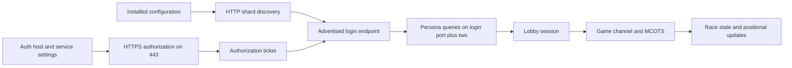

# Fan-server compatibility

The target is the server already configured in the supplied installation.
Discovery, pinned HTTPS authorization, binary account login, persona retrieval
and activation now have portable implementations. The client does not yet
establish an authenticated lobby or race session. Reaching
an open port is not sufficient evidence of protocol compatibility.

Current integration details are in [HTTPS authorization](https-authorization.md),
[binary login](binary-login-service.md), [TCP transport](nps-transport.md),
[persona requests](persona-protocol.md), and [lobby connection](lobby-connection.md).
The research sections below describe progressively recovered components; these
dedicated documents describe the current service boundaries and verification limits.

## Observed configuration and live services

On October 12, 2026, both installed shard-list URLs returned the same service
identity, `MotorCity Revival`, shard ID 44:

| Source | Configured URL |
| --- | --- |
| `shardlistip.ini` | `http://auth.novaserv.cc/ShardList` |
| `nps/shardlistip.ini` | `http://mc.novaserv.cc/ShardList` |

The discovery response advertises `mc.novaserv.cc` for login port 8226, lobby
port 7003 and MCOTS port 43300. All three accepted a TCP connection in the local
check. No login, lobby or transaction message was sent in that check. Endpoint
values and status can change; the implementation reads the configured URLs
rather than hardcoding this host into the client.

The installed 32-bit Windows registry separately sets `AuthLoginServer` to
`mc.novaserv.cc` and `AuthLoginBaseService` to `AuthLogin`. Static analysis of
`mcity.exe` at `0x4a46c0` and `0x72d820` traces those settings into loading
`nps/authlogin.dll` and resolving its authorization export. The original auth
DLL connects over HTTPS on port 443. This is distinct from the shard-list's
binary login endpoint on port 8226.



The diagram shows the intended connection sequence. Authorization, binary login
and persona operations are implemented as explicit service calls; their live
account acceptance remains unverified. Lobby session integration, game channels,
MCOTS session binding and the race sequence remain incomplete.

## Installed patch expectations

`scripts/MCOExOps.ini` enables Fast Join and selects positional update code 2,
documented by the patch as 32 Hz. Its existing runtime log reports skipping the
UDP-first branch at `0x4513c7` and changing the position-send mask at `0x5788e3`
from 7 to 1. Static analysis of `0x451370` also finds the original UDP channel
setup path. These agree about the patch's intended transport change; they do
not yet verify the reconstructed race-channel implementation.

The patch declares a SHA1 server-certificate pin. This value is read from the
local file and is not a public hardcoded fallback. Missing fields remain unknown;
positional code 0 means native behavior, whose rate is not invented by the reader.
TCP-first joining, send cadence, lag handling and content/version expectations
must be verified with the configured server before online compatibility is claimed.

## Certificate compatibility

The platform's default OpenSSL policy rejected the observed HTTPS certificate
with `EE certificate key too weak`. A certificate-only connection using a scoped
legacy policy negotiated TLS 1.3, and the certificate's fingerprint exactly
matched the installed patch pin. A subsequent pinned HTTPS GET to `/` returned
HTTP 200 and `OK`.

`PinnedHTTPSConnection` implements that explicit compatibility path: it permits
the legacy certificate policy only for that connection, keeps TLS 1.2 as its
minimum, and checks the exact configured certificate before sending HTTP bytes.
A mismatch closes the connection. It does not change global certificate settings
or install a Windows trust root. SHA1 pinning reproduces the installed patch's
certificate identity convention; it is not a recommendation for a new PKI design.

The unit suite checks that a mismatched certificate prevents an HTTP request's
payload from being sent. The [manual live transport run](https://github.com/Dadud/motor-city-reconstruction/actions/runs/38321930343)
also passed on both Ubuntu and Windows runners using the configured endpoint
and certificate pin. Both artifact reports record one parsed shard, an exact
certificate match and TLS 1.3, with no TLS application data sent. This establishes
cross-platform discovery and certificate transport, not authenticated gameplay.

## Recovered authorization format

The analyzed `authlogin.dll` has SHA-256
`b4822e997cd86c0890fafb6a395013d61daa413f70880d3e26e8b660a24635f6`.
Its request builder at `0x10001fa0` constructs a GET query containing `username`,
an optional `password`, `serviceID`, and `version=2.5`. Optional client-IP and
IGR fields exist in a separate branch. The service ID and complete caller
sequence must be recovered before a real login is attempted.

The password encoder at `0x100027d0` selectively percent-escapes punctuation,
using `%20` for a space rather than `+`. The portable helper supports printable
ASCII; original narrow-character behavior for other encodings remains unknown.
Username and service ID are appended differently in the original. The initial
portable interface rejects ambiguous query characters rather than allowing query
injection. It must be expanded with evidence if legitimate names require them.

The response parser at `0x10004090` consumes case-sensitive fields including
`Valid`, `reasoncode`, `reasontext` and `Ticket`. `Valid=TRUE` indicates the
native valid branch. Helpers at `0x10007010`, `0x100071b0` and `0x10007370`
establish newline-delimited entries, leading `#` comments, and separator
precedence `=`, space, tab, comma. The portable parser adds bounds and rejects
a success without a ticket. Exact native tolerance for malformed responses is
not claimed.

Query targets contain credentials. Do not log them, place them in command-line
arguments, commit them or export them as evidence. Ticket and diagnostic text
are excluded from the response object's representation. No real credentials
have been submitted by the reconstruction during these checks.

## Reproduce discovery and certificate checks

```powershell
.\.venv\Scripts\python.exe -m tools.server_check 'C:\Program Files (x86)\EA Games\Motor City Online' --fetch --check-auth-tls
```

```sh
python -m tools.server_check '/path/to/game' --fetch --check-auth-tls --auth-host mc.novaserv.cc
```

The explicit Linux host above reflects this installation's observed registry
value. Select the host from the user's actual configuration for another server.
The TLS option performs certificate verification without application data;
`--fetch` performs public discovery GETs. The report labels its limited coverage.
No account creation or persistent original configuration changes occur.

## Evidence required for confidence

### Encrypted lobby receive envelope

Receiver `0x7414b0` reads the four-byte message prefix, checks the declared size
against a 60000-byte upper limit, and reads the rest. When its ID is `0x1101`,
it submits exactly `outer_length - 4` ciphertext bytes to the receive filter,
signals message end through virtual offset `0x10`, drains the output, and parses
the decrypted message's own prefix. It then dispatches the inner message.
Thus the encrypted wrapper has four prefix bytes, not the 12-byte login header.

`client/lobby_envelope.py` accepts this wrapper and a caller-managed cipher,
validates aligned ciphertext and inner length, and returns the inner `Frame`
with any trailing block padding retained separately. It does not strip presumed
zero bytes or reset/reuse a cipher automatically. Native filter lifecycle remains
unverified; callers must close the connection after a decoding failure rather
than reuse possibly advanced cipher state. The decoder is not attached to a live
connection. Tests cover wrapper bounds, byte offsets, inner length consistency,
and preservation of opaque padding. These are synthetic checks, not native
end-to-end message equivalence or authenticated server tests.

Receive evidence:
`ev_4032c0c570e9560645fbe2d1dac34984fd22c1bb00696784602d7cd9c620075e`.

### Lobby session block cipher

Lobby crypto setup `0x73f470` bypasses encryption when the key-record length is
zero. Otherwise it constructs separate forward/reversed schedules through
`0x7ce230` using the first eight material bytes, initializes an eight-byte IV
to zero, and constructs separate send/receive filter objects. The key schedule
and block routine `0x7ce600` match standard DES: six emulated checks passed for
three synthetic keys/blocks in both directions, including the standard DES
example key and plaintext. The independent reference uses cryptography's
TripleDES with K,K,K, which is equivalent to DES.

Install the optional oracle dependencies and repeat with:

```sh
python -m pip install -e '.[oracle]'
python -m tools.nps_cipher_oracle '/path/to/original/mcity.exe'
```

The oracle runs original schedule and block instructions, replacing allocator
and free boundaries with bounded emulator memory. No host services execute.
These emulated checks establish the block primitive only. Subsequent filter
recovery identifies CBC chaining: `0x7cefc0` XORs incoming plaintext into the
stored previous ciphertext and encrypts in place; `0x7cf140` decrypts incoming
ciphertext, XORs the previous ciphertext, emits the result, and retains the
incoming ciphertext as the next chain value. Helper `0x7d18d0` performs the XOR.

`client/lobby_cipher.py` provides a complete-block DES-CBC adapter through the
optional `network` dependency. The zero IV reproduces observed initialization;
updates preserve chaining and require eight-byte alignment. Tests cover the
standard DES first-block vector, split versus combined CBC updates, decryption,
input bounds and closed state. These tests do not establish native filter
equivalence across complete messages.

The encryption tail handler at `0x7cf010` combines only supplied tail bytes before
encrypting a full block; the decryption tail handler at `0x7cf1b0` returns without
processing. Native filter buffering, tail padding, message-end signaling,
per-message versus connection chaining, and reconnect/reset behavior still
require verification. No adapter has been connected to the game transport yet.

Further original-instruction comparisons verified three CBC encryption cases,
each with two full blocks and a five-byte tail, against standard DES-CBC with a
zero-filled final block. `tools.nps_cipher_oracle` now runs the original full
block/tail filter handlers as well as the key schedule/block primitive. Only its
output sink and memory allocation use emulator stubs. `encrypt_message` applies
that observed zero-fill rule and emits no additional block for aligned or empty
input, preserving the chain between calls.

Message-end thunk `0x7cfc10` leads to `0x7cb780`: it drains buffered tail bytes,
invokes the tail handler and resets the buffering object through `0x7cb290`.
Those recovered operations do not reset the CBC chain buffer. This supports
preserving the chain across message-end calls; other caller-driven resets and
reconnect behavior remain unresolved. Message-end evidence:
`ev_12e1602dbdb959a390ffb177ca18da9236ab277a9e2b6bc10da22481136020d2`.
The 32-byte login record is not evidence that this path consumes a 256-bit key:
the recovered DES setup reads only eight bytes.

Setup evidence:
`ev_7821cd60e3cdf7b82309b54d1386191fa22e1e33245f52f7f7802d8940cfdf45`.
Schedule evidence:
`ev_6a76d9f887b4e4823899ccd41d1bf8115bcd27275b0f2b57ee7b37d0f6a5932c`.
Block evidence:
`ev_be392c94b7413ade85b602cbc2e7cbd6c8db9b7825c9a0136c3c9d613d41c1f9`.
Encryption-chain evidence:
`ev_9410e03837d1d9a45b7395de9a1952517a79515ac91aa6e5bae4a3610812944c`.
XOR evidence:
`ev_5e7fa8cf3b91612052a99bc928a80cf27e545253049c07f31cb71e654a0f16ce`.

### Preparing the encrypted session field

The global key object passed to `0x72c3f0` begins at `0x00b37e84`. The 32-byte
material copied by `0x72a8f0` starts at object offset `0x20`; its length is set
to 32. The login path explicitly clears object offset `0x18`, disabling the
outer header. Serializer `0x71d6d0` writes uint16 length, those bytes, and a uint32
field from object offset `0x44`. Three original-instruction checks matched the
authored `SessionKeyRecord.encode`, including binary data and the full capacity.

`client/nps_session_request.py` assembles the recovered pieces without contacting
a server: external public key and executable checksum, caller-supplied ticket,
fresh 32-byte OS-generated material, header-free key-record serialization, RSA
OAEP encryption with a fresh 20-byte seed, service ID `2176`, and message `0x501`.
It requires an explicit key-record value because that field's initial state and
meaning remain incompletely traced. It retains the private material for later
session handling and excludes both material and wire bytes from diagnostic reprs.

The request header's default auxiliary value is the total length: `0x7e0800`
zeroes the header and invokes `0x71be60` before writing flags, so that helper's
length-plus-flags calculation sees zero flags. This ordering is distinct from
interpreting the same helper after a received header already contains flags.
The assembly helper sets that value explicitly. The original full-message
serializer now matches all 42 synthetic cases byte for byte, including its size
method, default auxiliary calculation, flags and payload. The oracle runs the
real vtable and `0x7e0800`, substitutes a bounded emulator allocation, and supplies
specified htons/htonl/ntohs/ntohl byte swaps. Native RSA ciphertext comparisons
remain required; this is not a live login API.

### Service ID and executable checksum

The game login caller `0x5eda30` supplies service literal `2176` from `0x8b7358`
and global `0x00a38a18` as its fourth login argument. Wrapper `0x4a7ba0` retains
the service string. Checksum setup `0x5240b0` obtains the running executable's
filename, reads its complete file bytes, and calls `0x658280`.

The checksum routine starts at `0xffffffff`, uses the reflected CRC-32 table at
`0x8bdcc8`, and omits the final complement. `client/nps_identity.py` therefore
uses `zlib.crc32(data) ^ 0xffffffff`. Four emulated cases matched the original
instructions, including empty input, the standard CRC check string, binary data,
and a 4096-byte input. Repeat with:

```sh
python -m tools.nps_identity_oracle '/path/to/original/mcity.exe'
```

The portable helper reads the external original `mcity.exe` to reproduce its
identity value. The Python launcher's bytes do not reproduce that value. Whether
Revival accepts this identity for the reconstructed client remains untested.
The calculation is not evidence that arbitrary modifications are compatible.

Caller evidence:
`ev_f3a2c0290b10825534f8611cda52c373aac3824103bc9a70572cff549e6a8911`.
Checksum setup evidence:
`ev_5e361eda99c5c6557295d9da04d072800aeecca9c75fc5abc33ffe2c057514a0`.
Checksum instruction evidence:
`ev_845ede42f71e5874074abb89dde0407172aa653a3a8989ea5ce38cab1deef2c0`.

### Login success response

`client/nps_response.py` decodes the `0x601` payload read by native function
`0x72bf90`. Its recovered order is two big-endian uint32 values (the login caller
uses the first as user ID), one byte converted to boolean, three nested records,
another uint32, and a length-prefixed string of up to 64 bytes. Each nested record
has a big-endian uint16 byte length and contains payload without an outer header.

The first two records are read by `0x72bcf0`: three uint32 values, followed by
strings with capacities 64, 256, and 256 bytes. Native `0x72bd80` checks whether
the second uint32 is nonzero and the third is zero or greater than the current
signed 32-bit `time_t`. The authored `active_at` method preserves that signed
expiry comparison, including the original post-2038 limitation.

The third record is read by `0x71d700`: a length-prefixed field of up to 32 bytes
and a uint32 value. The login caller retains this material for its session.
The decoder does not yet infer a cipher or interpret the remaining numeric fields.
Sensitive strings and session material are excluded from diagnostic reprs.

The original reader comparison matched three synthetic cases containing zero,
one, and 32-byte session material. It runs the original reader and nested virtual
methods under Unicorn, replacing only ntohs/ntohl with specified byte swaps.
It checks decoded fields and the final reader cursor. Repeat with:

```sh
python -m tools.nps_response_oracle '/path/to/original/mcity.exe'
```

The portable decoder rejects truncation, oversized fields, and trailing bytes.
The native bounded-string helper can truncate oversized fields and advance only
by the copied length; that malformed-input behavior is not reproduced. No live
successful response has been captured or decoded yet.

Response evidence:
`ev_cd949004a2b40d4aced0d994805387b832855d718a859420f40f77f3a73c346b`.
Nested record evidence:
`ev_5ad41516f233dd45ab7d8f8d8e454b55a2cc101985cf643a59215fe841982af2`.
Expiry evidence:
`ev_a172eb653ed0a675aef2a2f13d9fb22b47e8435e7e6ed034fd52700324af57fc`.

### Recovered binary framing

`client/nps_framing.py` implements the framing observed in the main executable
serializer at `0x7e0800` and receiver at `0x72f600`. The first two big-endian
16-bit fields contain message ID and total byte length. The receiver reads those
four bytes, then exactly the remaining length. Its socket helper at `0x7e2da0`
loops over partial reads; the sender at `0x7e2c80` retries partial sends.

The serializer's header-enabled branch writes this layout:

| Byte offset | Width | Observed value |
| --- | --- | --- |
| 0 | 2 | Message ID |
| 2 | 2 | Total length including header |
| 4 | 2 | `0x0101` for IDs `0x501..0x51a` and `0x521..0x526`, otherwise zero |
| 6 | 2 | Zero |
| 8 | 4 | Object field or virtual-method result; meaning unresolved |
| 12 | variable | Message-specific payload |

The receiver permits four-byte frames. Their purpose is unresolved, so the codec
retains them without pretending they contain a full message header. Unknown IDs
and payloads remain opaque. Framing tests cover every split point in a multi-frame
stream, single-byte fragments, coalesced frames, maximum length, malformed length,
and truncated EOF. These are synthetic tests, not captured successful logins.

The original login path sends ID `0x501` and handles `0x601` as success. Observed
failure branches include `0x602` (user not found), `0x610` (not authorized),
`0x623` (authorization denied), `0x626` (banned), and `0x637` (CRC mismatch).
CRC/session calculation and ticket binding remain unresolved.
No fabricated binary login messages have been submitted to the live server.

`client/nps_login.py` now implements the recovered `0x501` payload serializer at
`0x72c120`. Strings use a big-endian 16-bit byte count and exclude the trailing
NUL, as established by helper `0x7e0c90`. The field order is:

| Field | Wire representation | Original capacity/origin |
| --- | --- | --- |
| Ticket | Length-prefixed narrow string | 128 bytes; authorization response |
| Authorization mode | Big-endian uint16 | HTTPS branch sets 0; alternate NPS AAI branch sets 1 |
| Opaque string | Length-prefixed narrow string | 512 bytes; generated by `0x72c3f0` |
| Service ID | Length-prefixed narrow string | 64 bytes; login caller supplies it |
| Caller value | Big-endian uint32 | Fourth login argument; meaning unresolved |

The codec takes explicit bytes because original narrow-character encoding is
unresolved. It rejects embedded NULs and over-capacity fields instead of silently
truncating them. Ticket and opaque string are excluded from diagnostic reprs.
The original size method at `0x72c0d0` agrees with this layout: twelve payload
overhead bytes plus the three string lengths, and twelve more for the outer header.

The optional original-instruction comparison can be repeated with:

```sh
python -m tools.nps_oracle '/path/to/original/mcity.exe'
```

It matched all 42 synthetic cases on this installation, including empty strings,
maximum capacities, byte values above ASCII, and integer boundaries. It runs the
serializer in Unicorn with specified byte-swap replacements for htons/htonl;
it does not launch the original application or contact any server. No original
instruction bytes are distributed. String-writer evidence:
`ev_f7d17703e1f4a281400105e08d55133e39c9436c203b641b4993acfd40d9a654`.

Framing evidence: `ev_e4d6f3f4404e2fa696ae1b02193319a710dfe99d9c2d70ba75fc794aedc415a2`
and `ev_65be7ce780de4792efa74e5bceeede74cc91966d869c8b65af46bf35a59d1279`.
Partial-read evidence:
`ev_54a1840a6a1d790094b44888bf2811b1887ad74cf33c4c965eadaada3a77c7cd`.

### Session encryption recovery

The login helper `0x72c3f0` opens `pub.key` through a file source and then formats
its encryption result as uppercase hexadecimal (`0x7b75c0`/`0x7b7670`). The
installed key is 324 bytes of ASCII hexadecimal containing DER
SubjectPublicKeyInfo with an RSA-1024 modulus and exponent 65537. Its SHA256 is
`6b134da9afbefa3e2872f5001ab72b570d892f390f5b0878fbcef827c7242cba`.
The key remains an external installation resource, not a hardcoded repository
constant. Native filename evidence:
`ev_9d5117fcb629ea54a9663d27f88e75e22c846bbef9489e06529c1dfde76fb714`.

The masking helper `0x7c7cb0` hashes a seed followed by a four-byte counter starting
at zero. Its call to `0x7b69b0` explicitly selects big-endian counter order. The
hash initializer `0x7d22a0` sets the five SHA-1 initialization words; compression
at `0x7d22e0` has the SHA-1 rounds and constants. The original compression
instructions matched standard SHA-1 in seven emulated cases, covering empty,
short, padding-boundary, multi-block, and binary inputs. Repeat with:

```sh
python -m tools.nps_hash_oracle '/path/to/original/mcity.exe'
```

`client/nps_crypto.py` implements that SHA-1 mask expansion with bounded inputs.
The padding routine at `0x7c7a80` uses two masks, a 20-byte seed, a 20-byte hash,
zero fill and a `0x01` separator. The authored empty-label OAEP data block matched
nine original-instruction cases at three block sizes, including empty and maximum
messages. The oracle supplies the independently verified empty-label SHA-1 digest
and runs range `0x7c7b33..0x7c7b82`; it does not verify native allocation, both mask
calls, or the final RSA operation end to end.

The module now parses bounded hexadecimal RSA SubjectPublicKeyInfo, builds
SHA-1 OAEP padding, performs the public RSA operation, and produces uppercase hex.
Independent checks with cryptography 50.0.2 decrypted all six synthetic ciphertexts
using ephemeral generated RSA-1024/RSA-2048 private keys. This proves standard
OAEP interoperability for those cases, not complete original-session equivalence.
The installed key parses to a 128-byte RSA block and a 256-byte hex ciphertext;
neither the key contents nor ciphertexts are published.

The native random pool uses a time-derived input. Portable encryption takes an
explicit 20-byte seed for reproducible checks; live callers must supply fresh
unpredictable bytes. `prepare_login` supplies fresh OS entropy, service ID `2176`
and the recovered executable checksum, then builds the full request. Its caller
uses the [recovered startup zero](nps-key-initialization.md) for the trailing
key-record value unless a research override is supplied. The binary login
service decodes success and retains the original request key separately.
Full native encryption comparison and live account/session acceptance remain
unverified.

Mask evidence: `ev_909a700466e65e54216134b28247becab4ed1357c1dc309c4a13a3360dc09389`.
Counter evidence: `ev_553b79d135e4703afd0994cc762f9ce8d078e97bfd94a642877ae7ce9bfa7314`.
SHA-1 compression evidence:
`ev_b7a76874e5e0bf89a72bca70c642254f2c431d838efb576a2fb5d45f590b0fe8`.

| Stage | Current evidence | Remaining requirement |
| --- | --- | --- |
| Discovery | Both live INI responses parsed | Cross-platform original precedence and failure behavior |
| HTTPS identity | Installed pin matches; live Ubuntu/Windows discovery and TLS checks passed | Reconnect, expiry and certificate rotation behavior |
| Authorization | Original DLL request/response stages traced; portable pinned HTTPS service; real local TLS check with synthetic credentials | Real successful ticket, rejection/expiry behavior |
| Binary login and persona | Portable request services and response handling; native serializer comparisons; login and persona endpoints reachable | Key-record value resolution, full native RSA comparison and authenticated acceptance |
| Lobby | Endpoint reachable; login payload, cipher and reply codecs recovered and checked | Live connection integration, join, lists, rooms, disconnect and reconnect |
| MCOTS | Endpoint reachable | Session binding and read-only state retrieval before mutations |
| Racing | Patch transport/rate settings identified | Join, start, position exchange, finish and multiplayer testing |
| Add-ons | Mod kit design | Server-authorized content and simulation compatibility rules |

Real end-to-end verification will need the user's authorized account session.
Use a private local login prompt or UI; do not request passwords in chat.
Do not promote transport or synthetic test results into a claim of trouble-free
server compatibility.

Local retained REA references include auth setup
`ev_7cc32501b657a6df8b67f09f2743a5053945cdaa881e4b08f1515793946f10f1`,
the authorization request
`ev_6ce86436747de248e3b58b54d1288ab8b5ff4c608b8636e5e2a44b817b0b106c`,
and response interpretation
`ev_e869b2d1f8b4a5929d10abb49ef2797d9ca7e73c54d06f01d3857117f7133ef4`.
Raw pseudocode and local captures remain excluded from the repository.
