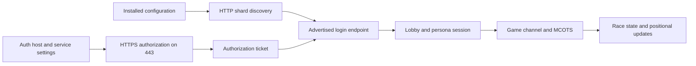

# Fan-server compatibility

The target is the server already configured in the supplied installation.
Discovery and certificate transport are implemented as developer tools. The
client does not yet establish an authenticated lobby or race session. Reaching
an open port is not sufficient evidence of protocol compatibility.

## Observed configuration and live services

On October 12, 2026, both installed shard-list URLs returned the same service
identity, `MotorCity Revival`, shard ID 44:

| Source | Configured URL |
| --- | --- |
| `shardlistip.ini` | `http://auth.novaserv.cc/ShardList` |
| `nps/shardlistip.ini` | `http://mc.novaserv.cc/ShardList` |

The discovery response advertises `mc.novaserv.cc` for login port 8226, lobby
port 7003 and MCOTS port 43300. All three accepted a TCP connection in the local
check. No login, lobby or transaction message was sent in that check. Endpoint
values and status can change; the implementation reads the configured URLs
rather than hardcoding this host into the client.

The installed 32-bit Windows registry separately sets `AuthLoginServer` to
`mc.novaserv.cc` and `AuthLoginBaseService` to `AuthLogin`. Static analysis of
`mcity.exe` at `0x4a46c0` and `0x72d820` traces those settings into loading
`nps/authlogin.dll` and resolving its authorization export. The original auth
DLL connects over HTTPS on port 443. This is distinct from the shard-list's
binary login endpoint on port 8226.



The later links show the integration path to recover and verify, not completed
portable functionality. The exact ticket handoff, packet framing, encryption,
session state and race sequence remain incomplete.

## Installed patch expectations

`scripts/MCOExOps.ini` enables Fast Join and selects positional update code 2,
documented by the patch as 32 Hz. Its existing runtime log reports skipping the
UDP-first branch at `0x4513c7` and changing the position-send mask at `0x5788e3`
from 7 to 1. Static analysis of `0x451370` also finds the original UDP channel
setup path. These agree about the patch's intended transport change; they do
not yet verify the reconstructed race-channel implementation.

The patch declares a SHA1 server-certificate pin. This value is read from the
local file and is not a public hardcoded fallback. Missing fields remain unknown;
positional code 0 means native behavior, whose rate is not invented by the reader.
TCP-first joining, send cadence, lag handling and content/version expectations
must be verified with the configured server before online compatibility is claimed.

## Certificate compatibility

The platform's default OpenSSL policy rejected the observed HTTPS certificate
with `EE certificate key too weak`. A certificate-only connection using a scoped
legacy policy negotiated TLS 1.3, and the certificate's fingerprint exactly
matched the installed patch pin. A subsequent pinned HTTPS GET to `/` returned
HTTP 200 and `OK`.

`PinnedHTTPSConnection` implements that explicit compatibility path: it permits
the legacy certificate policy only for that connection, keeps TLS 1.2 as its
minimum, and checks the exact configured certificate before sending HTTP bytes.
A mismatch closes the connection. It does not change global certificate settings
or install a Windows trust root. SHA1 pinning reproduces the installed patch's
certificate identity convention; it is not a recommendation for a new PKI design.

The unit suite checks that a mismatched certificate prevents an HTTP request's
payload from being sent. Linux's default TLS and the legacy pinned connection
still require an actual server transport check on Linux; passing mocked tests
alone does not establish that result.

## Recovered authorization format

The analyzed `authlogin.dll` has SHA-256
`b4822e997cd86c0890fafb6a395013d61daa413f70880d3e26e8b660a24635f6`.
Its request builder at `0x10001fa0` constructs a GET query containing `username`,
an optional `password`, `serviceID`, and `version=2.5`. Optional client-IP and
IGR fields exist in a separate branch. The service ID and complete caller
sequence must be recovered before a real login is attempted.

The password encoder at `0x100027d0` selectively percent-escapes punctuation,
using `%20` for a space rather than `+`. The portable helper supports printable
ASCII; original narrow-character behavior for other encodings remains unknown.
Username and service ID are appended differently in the original. The initial
portable interface rejects ambiguous query characters rather than allowing query
injection. It must be expanded with evidence if legitimate names require them.

The response parser at `0x10004090` consumes case-sensitive fields including
`Valid`, `reasoncode`, `reasontext` and `Ticket`. `Valid=TRUE` indicates the
native valid branch. Helpers at `0x10007010`, `0x100071b0` and `0x10007370`
establish newline-delimited entries, leading `#` comments, and separator
precedence `=`, space, tab, comma. The portable parser adds bounds and rejects
a success without a ticket. Exact native tolerance for malformed responses is
not claimed.

Query targets contain credentials. Do not log them, place them in command-line
arguments, commit them or export them as evidence. Ticket and diagnostic text
are excluded from the response object's representation. No real credentials
have been submitted by the reconstruction during these checks.

## Reproduce discovery and certificate checks

```powershell
.\.venv\Scripts\python.exe -m tools.server_check 'C:\Program Files (x86)\EA Games\Motor City Online' --fetch --check-auth-tls
```

```sh
python -m tools.server_check '/path/to/game' --fetch --check-auth-tls --auth-host mc.novaserv.cc
```

The explicit Linux host above reflects this installation's observed registry
value. Select the host from the user's actual configuration for another server.
The TLS option performs certificate verification without application data;
`--fetch` performs public discovery GETs. The report labels its limited coverage.
No account creation or persistent original configuration changes occur.

## Evidence required for confidence

| Stage | Current evidence | Remaining requirement |
| --- | --- | --- |
| Discovery | Both live INI responses parsed | Cross-platform original precedence and failure behavior |
| HTTPS identity | Installed pin matches; pinned TLS and public GET succeeded on Windows | Linux transport and reconnect checks |
| Authorization format | Original DLL request/response stages traced; synthetic tests | Caller service ID, real successful ticket, rejection/expiry behavior |
| Binary login and persona | Endpoint reachable; original client leads | Codec, session/crypto flow and authenticated persona retrieval |
| Lobby | Endpoint reachable | Join, lists, rooms, disconnect and reconnect |
| MCOTS | Endpoint reachable | Session binding and read-only state retrieval before mutations |
| Racing | Patch transport/rate settings identified | Join, start, position exchange, finish and multiplayer testing |
| Add-ons | Mod kit design | Server-authorized content and simulation compatibility rules |

Real end-to-end verification will need the user's authorized account session.
Use a private local login prompt or UI; do not request passwords in chat.
Do not promote transport or synthetic test results into a claim of trouble-free
server compatibility.

Local retained REA references include auth setup
`ev_7cc32501b657a6df8b67f09f2743a5053945cdaa881e4b08f1515793946f10f1`,
the authorization request
`ev_6ce86436747de248e3b58b54d1288ab8b5ff4c608b8636e5e2a44b817b0b106c`,
and response interpretation
`ev_e869b2d1f8b4a5929d10abb49ef2797d9ca7e73c54d06f01d3857117f7133ef4`.
Raw pseudocode and local captures remain excluded from the repository.
